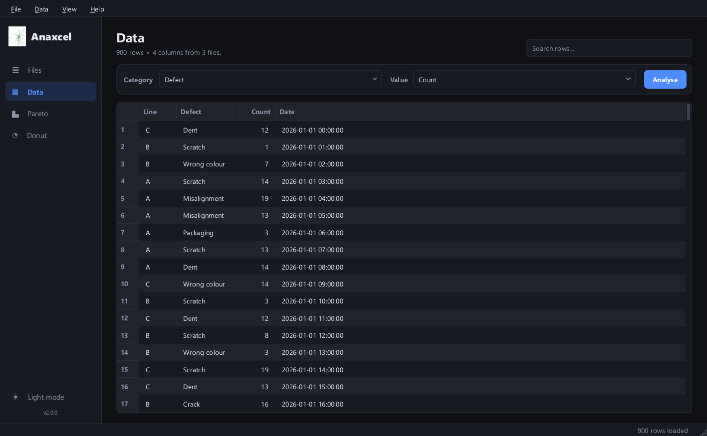
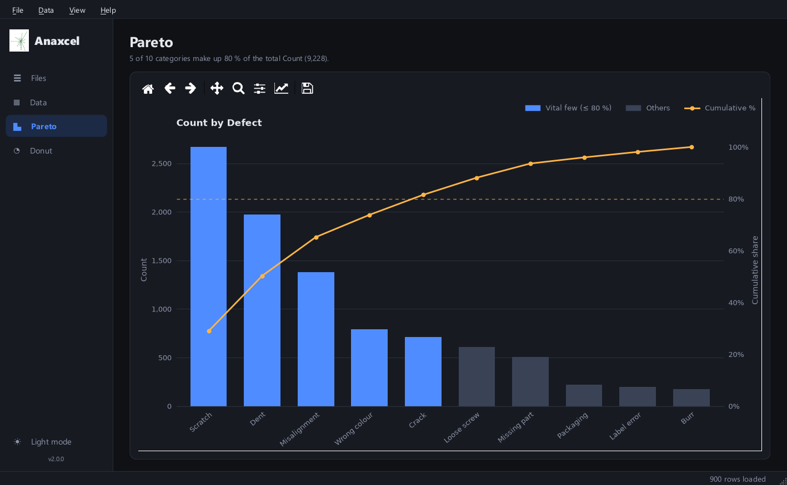
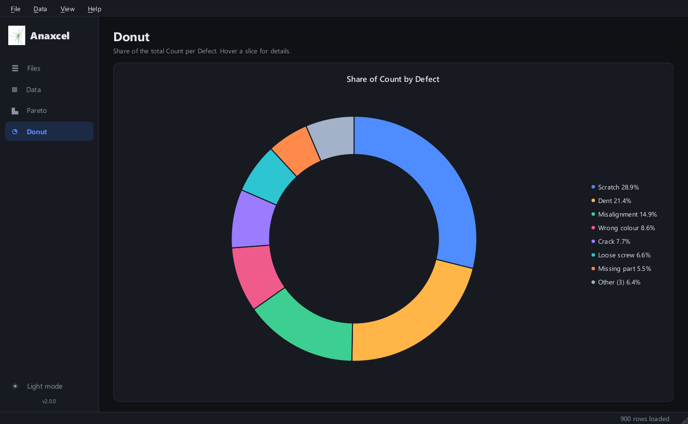
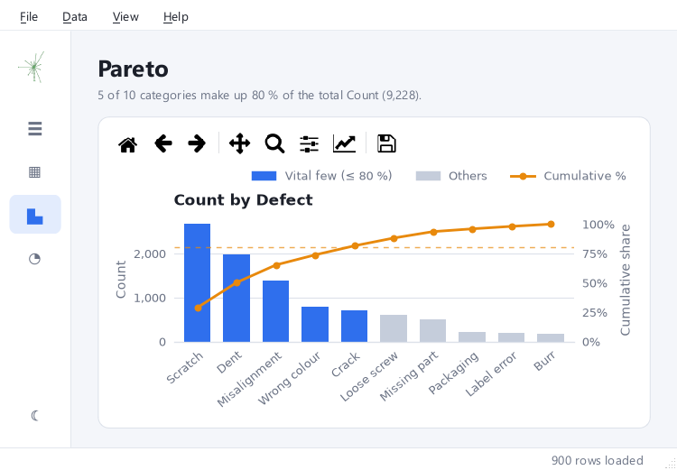

# Anaxcel

A Python desktop app for combining Excel/CSV files and analysing them with Pareto and donut charts.

Anaxcel is free software under the GPLv2 license.



## Features

- Load several `.xls`, `.xlsx`, `.xlsm` and `.csv` files at once. Add them with the button or by drag and drop, and they are combined into one table.
- A fast table view that handles hundreds of thousands of rows. Click a column header to sort it, and use the search box to filter rows.
- A **Pareto chart** that highlights the "vital few" categories making up 80 % of the total. Hover a bar to see its values.
- A **donut chart** that shows each category's share of the total.
- Export the visible rows to `.xlsx` or `.csv`.
- Light and dark themes. The window scales with any screen size and DPI, and the sidebar shrinks to icons when the window is narrow.

## Getting started

Requires Python 3.9 or newer.

```
py -m pip install -r requirements.txt
py main.py
```

On macOS or Linux, use `python3` instead of `py`. You can also pass files when starting the app: `py main.py data1.xlsx data2.csv`.

## Usage

1. **Files**: add spreadsheets, then click **Load**. Only the selected files are loaded, or all of them if none are selected. Clear *First row contains column names* if your files have no header row.
2. **Data**: check the combined table. Pick a **Category** column (what to group by) and a **Value** column (what to add up), then click **Analyse**.
3. **Pareto / Donut**: explore the charts. Use the chart toolbar to zoom, pan or save as an image.

| Pareto | Donut |
|---|---|
|  |  |

Light theme in a small window:



### Keyboard shortcuts

| Action | Shortcut |
|---|---|
| Add files | Ctrl+O |
| Load files | Ctrl+L |
| Analyse | Ctrl+R |
| Export data | Ctrl+E |
| Switch page | Ctrl+1 … Ctrl+4 |
| Toggle theme | Ctrl+T |
| Remove selected files | Del (in the file list) |
| About | F1 |

## Project layout

```
main.py            entry point
lib/anaxcel.py     main window: behaviour and wiring
lib/anaxcelgui.py  main window: layout and widgets
lib/charts.py      Pareto (matplotlib) and donut (Qt Charts) widgets
lib/core.py        file loading, Pareto maths, table model (no widgets)
lib/theme.py       light/dark colour tokens and stylesheet
lib/dialogs.py     About and License dialogs
assets/            icons and screenshots
```

## License

Released under the GNU General Public License, version 2.
